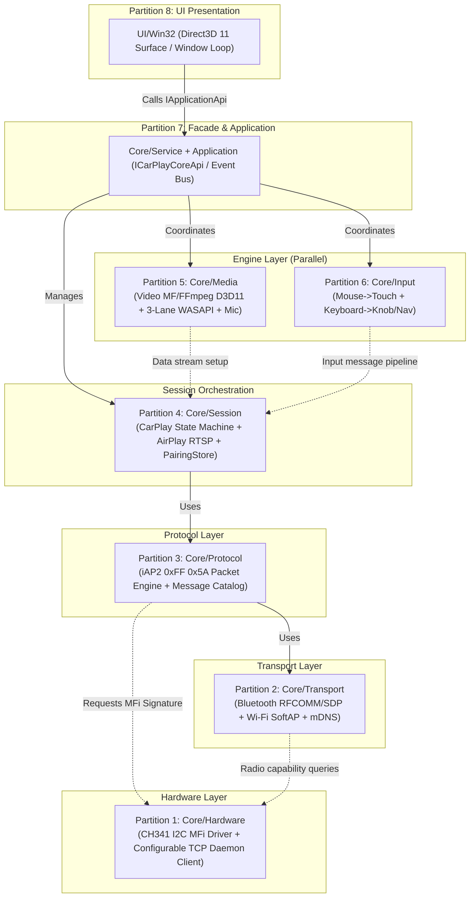

# CarPlayStation — Multi-Agent Partition Directives (AI Partitions & Prompts)

This document is designed for **concurrent multi-agent development across different IDEs or AI clients** (e.g., Antigravity, Cursor, VS Code, Claude, ChatGPT, Copilot). By enforcing strict **directory locks**, **pure virtual interface contracts**, and **Mock-First development**, multiple AI agents can implement and test decoupled modules concurrently **without code conflicts, regressions, or blocking dependencies**.

---

## Table of Contents
1. [Zero-Collision Rules for Multi-Agent Workflows](#1-zero-collision-rules-for-multi-agent-workflows)
2. [Partition Map & Dependency Topology](#2-partition-map--dependency-topology)
3. [Partition Prompts (Ready-to-Copy Task Instructions)](#3-partition-prompts-ready-to-copy-task-instructions)
   - [Partition 1: Hardware Abstraction & MFi Bridges (Core/Hardware)](#partition-1-hardware-abstraction--mfi-bridges)
   - [Partition 2: Transport & Link Layer (Core/Transport)](#partition-2-transport--link-layer)
   - [Partition 3: iAP2 Protocol & Framing (Core/Protocol)](#partition-3-iap2-protocol--framing)
   - [Partition 4: Session State Machine & AirPlay (Core/Session)](#partition-4-session-state-machine--airplay)
   - [Partition 5: Media Streaming Pipelines (Core/Media)](#partition-5-media-streaming-pipelines)
   - [Partition 6: Input Translation & Navigation (Core/Input)](#partition-6-input-translation--navigation)
   - [Partition 7: Core Service Facade & Application Layer (Core/Service & Application)](#partition-7-core-service-facade--application-layer)
   - [Partition 8: Win32 UI & Desktop Presentation (UI/Win32)](#partition-8-win32-ui--desktop-presentation)

---

## 1. Zero-Collision Rules for Multi-Agent Workflows

When starting a session in any AI assistant client, **pass these 4 core rules to the AI**:

1. **Strict Directory Lock**:
   - The AI must only create, modify, or delete files within its assigned directory.
   - **Never** modify private implementation files belonging to other partitions.
2. **Interface-First Contracts (Pure Virtual Headers)**:
   - All inter-module capabilities must be exposed via abstract pure virtual base classes (e.g. `IMfiSigner.h`, `ITransportChannel.h`, `IVideoDecoder.h`).
   - Consumer modules only `#include` the public interface header, never private implementation classes.
3. **Mock-First & Standalone Testing**:
   - If a downstream layer is not yet implemented, **do not wait or implement it across directories**. Write mock classes (e.g. `MockMfiSigner`, `MockTransportChannel`) inside your partition's test suite to validate functionality independently.
4. **Code Standards**:
   - Standard: Modern C++20 (MSVC on Windows 10/11).
   - Memory Management: Modern RAII (`std::unique_ptr`, `std::shared_ptr`, `std::span`), zero raw-pointer ownership.
   - Configurable Endpoints: Never hardcode IP/port values. Network daemons, proxy addresses, and endpoints must be configurable (e.g. via configuration structs/strings with defaults like `127.0.0.1:9000`).

---

## 2. Partition Map & Dependency Topology



---

## 3. Partition Prompts (Ready-to-Copy Task Instructions)

Copy the prompt block below into the designated AI agent workspace:

---

### Partition 1: Hardware Abstraction & MFi Bridges

```markdown
[AI Work Order - Partition 1: Hardware & MFi]
You are assigned to develop the [Layer 1: Core/Hardware] module of CarPlayStation.

1. Scope & Directory Lock:
   - Read/write exclusively inside `d:\CarPlayStation\Core\Hardware\` and its subdirectories.
   - Do NOT modify files outside this directory.

2. Core Objectives:
   - Design `IMfiSigner.h` (abstract pure virtual interface for retrieving certificates, generating challenge signatures, and querying chip status).
   - Implement `Ch341MfiBridge.h/.cpp`: USB-to-I2C bridge driver communicating with Apple MFi Coprocessor (CP3.0 / 2.0C, I2C address 0x22/0x20) using CH341 API.
   - Implement `NetworkMfiClient.h/.cpp`: WinSock TCP client connecting to a configurable MFi signing daemon/proxy address (e.g. configurable `MfiDaemonEndpoint` string/struct, defaulting to "127.0.0.1:9000").
   - Implement `MockMfiSigner.h`: Mock implementation providing predictable test vectors and dummy signatures for protocol testing.
   - Implement unit tests for I2C framing and TCP packet transactions against mock endpoints.

3. Standards:
   - C++20, Windows SDK, no hardcoded IP/ports, explicit error handling.
```

---

### Partition 2: Transport & Link Layer

```markdown
[AI Work Order - Partition 2: Transport & Link]
You are assigned to develop the [Layer 2: Core/Transport] module of CarPlayStation.

1. Scope & Directory Lock:
   - Read/write exclusively inside `d:\CarPlayStation\Core\Transport\` and its subdirectories.
   - Do NOT modify files outside this directory.

2. Core Objectives:
   - Design `ITransportChannel.h` (abstract stream interface: `AsyncSend`, `SetDataCallback`, `Disconnect`, `GetState`).
   - Implement `BtRfcommTransport.h/.cpp`: WinSock `AF_BTH` implementation for Bluetooth RFCOMM listening, data I/O, and iAP2 SDP record registration (UUID: `00000000-deca-fade-deca-deafdecacafe`).
   - Implement `WifiSoftApManager.h/.cpp`: Windows Native Wifi / HostedNetwork manager for starting/stopping SoftAP and generating dynamic credentials.
   - Implement `MdnsAdvertiser.h/.cpp`: Publishes `_airplay._tcp`, `_raop._tcp`, and `_carplay._tcp` mDNS service discovery records.
   - Implement `MockTransportChannel.h`: In-memory loopback transport channel for testing upper-layer protocols.

3. Standards:
   - Robust async I/O, non-blocking sockets, clean disconnect recovery.
```

---

### Partition 3: iAP2 Protocol & Framing

```markdown
[AI Work Order - Partition 3: Protocol (iAP2)]
You are assigned to develop the [Layer 3: Core/Protocol] module of CarPlayStation.

1. Scope & Directory Lock:
   - Read/write exclusively inside `d:\CarPlayStation\Core\Protocol\` and its subdirectories.
   - Do NOT modify files outside this directory.

2. Core Objectives:
   - Reference `Reference/carplayd` and `Reference/xcertplay` for iAP2 specifications.
   - Implement `Iap2LinkEngine.h/.cpp`: Parses 0xFF 0x5A start bytes, validates header/payload CheckByte, and manages SYN/ACK/EAK/RST state machine and sliding window sequencing.
   - Implement `Iap2SessionManager.h/.cpp`: Multiplexes Control Session (ID 1) and Data Sessions.
   - Implement `Iap2MessageCatalog.h/.cpp`: iAP2 message serialization/deserialization (Authentication, Identification, Wireless CarPlay Handshake, Vehicle Status).
   - Integrate with `IMfiSigner.h` to coordinate MFi challenge-response sequences.
   - Build a standalone packet replay test suite verifying parsing against recorded hex streams.

3. Standards:
   - Modern C++20 parsing with `std::span<const uint8_t>`, zero platform lock-in.
```

---

### Partition 4: Session State Machine & AirPlay

```markdown
[AI Work Order - Partition 4: Session & Orchestration]
You are assigned to develop the [Layer 4: Core/Session] module of CarPlayStation.

1. Scope & Directory Lock:
   - Read/write exclusively inside `d:\CarPlayStation\Core\Session\` and its subdirectories.
   - Do NOT modify files outside this directory.

2. Core Objectives:
   - Implement `CarPlaySessionStateMachine.h/.cpp`: Manages lifecycle states (`Idle` -> `BtDiscovered` -> `iAP2Authenticated` -> `WifiHandoff` -> `AirPlayStreaming` -> `Paused/Teardown`) with timeout and error recovery.
   - Implement `AirPlayRtspServer.h/.cpp`: Parses RTSP requests (ANNOUNCE, SETUP, RECORD, TEARDOWN) and negotiates video resolution, audio formats, and screen capabilities.
   - Implement `PairingStore.h/.cpp`: Persists paired iPhone keys and identifiers for automatic fast reconnect.
   - Implement unit tests covering various disconnect and timeout edge cases.

3. Standards:
   - Thread-safe state transitions and clean event notifications.
```

---

### Partition 5: Media Streaming Pipelines

```markdown
[AI Work Order - Partition 5: Media Streaming Engine]
You are assigned to develop the [Layer 5: Core/Media] module of CarPlayStation.

1. Scope & Directory Lock:
   - Read/write exclusively inside `d:\CarPlayStation\Core\Media\` and its subdirectories.
   - Do NOT modify files outside this directory.

2. Core Objectives:
   - Design `IVideoDecoder.h` with forward-compatible codec discovery (H264, HEVC, and future AV1/VP9/VVC).
   - Implement `AirPlayVideoDemuxer.h/.cpp` for NALU demuxing, Annex-B conversion, SPS/PPS extraction, and IDR resync.
   - Implement `MfVideoDecoder.h/.cpp` (Windows Media Foundation + Direct3D 11 hardware-accelerated H.264/HEVC decoder outputting to D3D11 shared texture handles via `IDXGIResource::GetSharedHandle`, sub-frame latency, zero-copy, EVR/madVR rejected).
   - Implement dynamic FFmpeg fallback (`FFmpegVideoDecoder.h/.cpp` via `d3d11va` / CPU) resolving Windows 10/11 retail lack of $0.99 Microsoft Store HEVC extension; integrate with automated dependency sync (`cmake/FindOrDownloadFFmpeg.cmake`).
   - Implement `WasapiAudioPipeline.h/.cpp`: non-exclusive WASAPI Shared Mode renderer (`AUDCLNT_SHAREMODE_SHARED`, 48kHz 16-bit Stereo PCM) with internal 3-Lane software mixer (MainMedia, AltNavigation, SiriTelephony) and soft-limiter.
   - Implement `AudioDuckingManager.h/.cpp`: smooth attack/release volume ducking curves for navigation and Siri prompts.
   - Implement `MicrophoneUplink.h/.cpp`: WASAPI mic capture and uplink stream encoding (16/24kHz mono).
   - Implement `MockVideoDecoder.h`, `MockAudioPipeline.h`, and `MockMicrophoneUplink.h` for headless test automation.
   - Never call UI window handles directly; deliver frames strictly via shared texture handles or callbacks.

3. Standards:
   - C++20, Windows SDK (Direct3D 11, Media Foundation, WASAPI), sub-frame latency optimization, no audio device monopolization (shared mode only).
```

---

### Partition 6: Input Translation & Navigation

```markdown
[AI Work Order - Partition 6: Input & Navigation]
You are assigned to develop the [Layer 6: Core/Input] module of CarPlayStation.

1. Scope & Directory Lock:
   - Read/write exclusively inside `d:\CarPlayStation\Core\Input\` and its subdirectories.
   - Do NOT modify files outside this directory.

2. Core Objectives:
   - Design `IInputEventSink.h` (pure abstract input event receiver).
   - Implement `MouseTouchTranslator.h/.cpp`:
     * Left click down/up -> Touch Down / Touch Up.
     * Left click drag -> Touch Move.
     * Right click -> Automotive Back / Home button.
     * Coordinate scaling between window dimensions and CarPlay resolution.
   - Implement `KeyboardKnobTranslator.h/.cpp`:
     * Arrow keys -> Rotary knob step rotation and directional navigation.
     * Enter -> Rotary knob push / select confirm.
     * Backspace / Esc -> Back.
     * Media & function hotkeys -> Play/Pause, Track Skip, Siri activate, Call control.
   - Implement unit tests validating coordinate transformations and packet generation.

3. Standards:
   - Pure mathematical/logic translation; no direct coupling to Win32 `HWND`.
```

---

### Partition 7: Core Service Facade & Application Layer

```markdown
[AI Work Order - Partition 7: Core Service & Application Layer]
You are assigned to develop the [Layer 7: Core/Service] and [Application] layers of CarPlayStation.

1. Scope & Directory Lock:
   - Read/write exclusively inside `d:\CarPlayStation\Core\Service\` and `d:\CarPlayStation\Application\`.
   - Do NOT modify private implementation code in other partitions.

2. Core Objectives:
   - Define the public C++ contract header `Core/Service/ICarPlayCoreApi.h` (start, stop, configure, event listeners, DTOs).
   - Implement `CarPlayCoreService.h/.cpp`: Facade managing the lifecycles of Layers 1-6.
   - Implement the `Application` state manager and command dispatcher exposing clean APIs to the UI.
   - Implement end-to-end mock integration tests driving full session lifecycles using Mock objects.

3. Standards:
   - Clean, high-cohesion, thread-safe public C++ API adhering to DEC-002.
```

---

### Partition 8: Win32 UI & Desktop Presentation

```markdown
[AI Work Order - Partition 8: Win32 UI & Desktop Presentation]
You are assigned to develop the [UI/Win32] desktop presentation layer of CarPlayStation.

1. Scope & Directory Lock:
   - Read/write exclusively inside `d:\CarPlayStation\UI\Win32\`.
   - Strictly forbidden from including private protocol headers of `Core/` (DEC-002).

2. Core Objectives:
   - Interface exclusively through `Application` layer headers.
   - Create the Win32 main application window with DPI scaling and fullscreen / borderless / windowed modes.
   - Implement Direct3D 11 SwapChain surface presenting video textures delivered from the Application layer.
   - Capture Windows mouse and keyboard messages and forward them to `IInputEventSink`.
   - Render lightweight status overlays (connection state, pairing prompts).

3. Standards:
   - Native Win32 C++, clean rendering loop, minimal CPU overhead.
```
