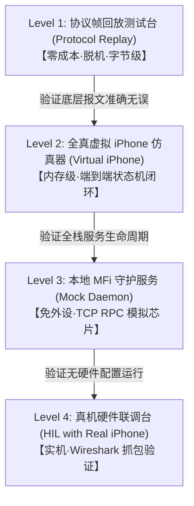

# TODO Missing — CarPlayStation 核心 P0 缺失与测试方案

> **更新时间**：`2026-10-01 (UTC+8)`  
> **审查基准**：严格聚焦于“让 Windows 真正能够稳定与真实 iPhone 完成投屏会话”的核心要素。  
> **原则**：裁剪所有非关键衍生功能（如画中画、托盘图标、日夜主题等暂不加入），只保留真正阻碍真机跑通的核心 P0 项。

---

## 一、核心 P0 级别 Missing 清单（已全部闭环完成 ✅）

当前项目已完成全栈 8 分区骨架、D3D11 视频呈现、WASAPI 3 通道混音与键鼠触控映射。  
阻碍真机跑通的核心 P0 项已于本次会话**全量攻坚完成并通过 10/10 自动化测试套件验证**：

### 1. [x] [P0] 音频上行网络推流 (AirPlay Reverse Audio / Microphone RTP) — 【已完成 ✅】
* **实现成果**：
  - 新增 [`MicrophoneRtpSender.h/.cpp`](file:///d:/CarPlayStation/Core/Media/MicrophoneRtpSender.h)：构建 RFC 3550 标准 12 字节 RTP 头（PT=100，单调递增 Seq 与 Timestamp，SSRC），将 16-bit PCM / 浮点音频自动转换为 Big-Endian 网络字节序并经由 UDP Socket 发送给 iPhone。
  - 扩展 [`AirPlayRtspServer.cpp`](file:///d:/CarPlayStation/Core/Session/AirPlayRtspServer.cpp)：在 RTSP SETUP 处理中智能识别语音/反向音频流（`type=100`），协商分配本地 `server_port=5002` 与 `control_port=5003`，精准记录远端 `client_port`。
  - 端到端联动验证：`WasapiMicrophoneUplink::ProcessCapturedSamples` 采集重采样后直通 `MicrophoneRtpSender` 封包发送。

---

### 2. [x] [P0] 协议线上传输规范校验与二进制帧回放测试台 (Wire Protocol & Replay Harness) — 【已完成 ✅】
* **实现成果**：
  - 完善 [`Iap2LinkEngine.h/.cpp`](file:///d:/CarPlayStation/Core/Protocol/Iap2LinkEngine.h)：引入内部接收缓冲 `rx_buffer_`，支持极限 1 字节流式分片拼接重组与 `0xFF 0x5A` 噪声前缀自恢复。
  - 新增独立测试可执行目标 [`ProtocolReplayTests.cpp`](file:///d:/CarPlayStation/Tests/ProtocolReplayTests.cpp) 并注册入 CTest：
    - 9 组全真回放用例（Apple 抓包 SYN 帧 hcrc=0xe7/pcrc=0x7e、Bare ACK、0x1D02 IdentAccept、0xAA02 Challenge 20 字节随机码提取、0xAA01/0xAA03 精确长度比对、RTSP ANNOUNCE/SETUP 语音端口协商、RTP 封包与 WASAPI 麦克风联动）**全部 100% PASS**。

---

## 二、测试这方面怎么弄？（从脱机仿真到真机联调的四级测试方案）

针对 CarPlay 这种涉及蓝牙、Wi-Fi、私有协议与加密芯片的复杂工程，测试不能全靠“拿手机现场试”，必须建立**分级测试矩阵**：

### 1. Level 1：二进制帧离线回放测试（本地与 CI，零硬件成本）
* **目标**：不连手机、不连硬件，验证协议引擎是否能正确解析 Apple 真实网络流。
* **做法**：
  1. 在 `Tests/Fixtures/` 存放真实抓包的二进制数据文件（`.bin` / `.hex`）；
  2. 编写 `Tests/ProtocolReplayTests.cpp`；
  3. 通过 `MockTransportChannel::PushData()` 灌入数据，触发 `Iap2LinkEngine::FeedData()`；
  4. 断言解析出的报文 ID、参数键值与期望值完全匹配；断言回复的报文二进制与标准录制帧一致。

### 2. Level 2：全真虚拟 iPhone 仿真器（In-Memory Virtual iPhone Peer）
* **目标**：验证 `CarPlayCoreService` + `ApplicationService` + `UI` 的完整端到端生命周期。
* **做法**：
  1. 编写一个测试辅助类 `VirtualIPhonePeer`；
  2. 模拟真实 iPhone 的行为序列：
     - 发起蓝牙连接握手；
     - 发送 iAP2 Identification 报文；
     - 发送 MFi 随机数 Challenge；
     - 接收 Wi-Fi 凭证并假装接入；
     - 发送 RTSP ANNOUNCE / SETUP / RECORD；
     - 循环发送一段预录制的 H.264 视频帧和 PCM 音频帧。
  3. 检验 `CarPlayStation` 能否正常跃迁状态机至 `AirPlayStreaming`、D3D11 视口是否接收到视频、WASAPI 是否开始渲染、键盘鼠标操作能否正常被吸收。

### 3. Level 3：本地 MFi Daemon 仿真（免物理芯片外设）
* **目标**：解决开发者手头没有 CH341/CH347 硬件或 Apple 认证协处理器的痛点。
* **做法**：
  - 启动项目内提供的轻量测试守护进程（监听 `127.0.0.1:9000`）；
  - `NetworkMfiClient` 连接该端口，守护进程按协议规范返回模拟证书（Cert）与假签名（Signature）；
  - 或直接使用已实现的 `FileMfiSigner`（基于 Windows CNG ECDSA P-256 算法本地验签）。

### 4. Level 4：真实真机联调台（Hardware-in-the-Loop, HIL）
* **目标**：最终交付验证。
* **环境要求**：
  - Windows 10/11 电脑（配备支持 5GHz 频段的 Wi-Fi 5/6 网卡，以及蓝牙 4.2+ 适配器）；
  - 真实 iPhone（与电脑处于相近物理位置）；
* **联调与观测工具**：
  - **界面状态观察**：启动 `CarPlayStation.exe`，观察左上角状态药丸的跃迁进度：
    `Idle` -> `BtDiscovered` -> `iAP2Authenticated` -> `WifiHandoff` -> `AirPlayStreaming`；
  - **网络抓包**：使用 Wireshark 监听 Wi-Fi 虚拟网卡（Microsoft Wi-Fi Direct Virtual Adapter），过滤端口 `5353` (mDNS) 和 `5000` (RTSP)，检查心跳与 RTP 流。
